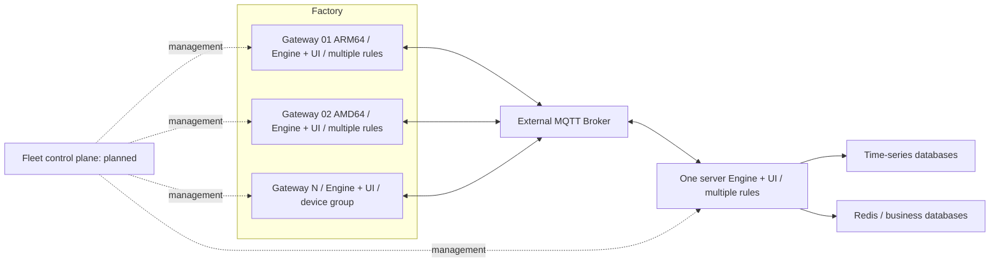

# IoT Rule Engine

**Everything is a plugin. The core handles orchestration and governance.**

[简体中文](README.md) | [English](README.en.md)

A Go industrial rule engine with a visual management UI. A factory can run many
independent Linux AMD64/ARM64 collection gateways, each serving one device or a
device group. One server-side Engine runs multiple rules to aggregate their data
through an external MQTT broker.

## Architecture



Edge uplink: PLC Source → transform → persistent buffer → MQTT Sink.
Edge downlink: MQTT Source → target/expiry validation → PLC Sink.
Server rules: MQTT Source → processing/mapping → database sinks.

Connector Resources are shared across rules within one Engine. Gateways own
separate connections and identities. A plugin artifact runs in one OS process
with independent rule-node objects. S7 uses demand-aware sessions and serialized
device IO; MQTT can retain a connection. S7 is supported; full FANUC/Mitsubishi
plugins and Fleet management remain planned.

## Start from source

Go 1.25+ and Node.js 22 are required. Repositories build independently without
go.work or local replacements.

```bash
export GOWORK=off
export IOT_RULE_ADMIN_PASSWORD='Replace-With-A-Strong1!'
export IOT_RULE_DATA_DIR="$PWD/data"
export IOT_RULE_LISTEN='127.0.0.1:11011'
export IOT_RULE_INSTANCE_ID='factory-a-gateway-01'
go run ./cmd
```

Run `npm ci && npm start` in `ui/` for development. Release builds embed the UI
and default configuration in the executable; SQLite initializes on first start.
The administrator password is stored only as a bcrypt hash. An explicit
`--config configs/config.yaml` retains YAML bootstrap compatibility.

## Install and extend

`deploy/release.sh` produces a signed platform package. The reviewed installer
`deploy/iot-rule-engine.sh` supports Linux AMD64/ARM64, systemd, upgrade checks,
database backup and health-failure recovery. Plugins are separate downloads,
selected by ID/version/platform in the UI marketplace. Hub and Engine verify
checksums, publisher signatures, platform and plugin identity. Active references
block replacement; verified versions are cached for rollback.

Reliable mode persists rule edges and confirms them after node execution.
The disk buffer retains events until the designated sink confirms them. MQTT
PUBACK is broker receipt, not database commit; receivers require event-ID
idempotence and stronger applications require business receipts.

## Node-RED comparison

Node-RED offers a mature general-purpose visual editor and npm node ecosystem.
Its configuration nodes also share connections. IoT Rule Engine focuses on
first-class Connector governance, protocol-specific lifecycles, plugin process
isolation and signed artifacts. No unmeasured performance advantage is claimed.

See [the comparison and primary sources](docs/node-red-comparison.md),
[multi-gateway architecture](docs/multi-gateway.md),
[verification scope](docs/engineering-verification.md), and [all docs](docs/README.md).

## Validation

```bash
GOWORK=off go test ./...
GOWORK=off go test -race ./...
GOWORK=off go vet ./...
cd ui && CI=true npm test -- --runInBand && npm run build
```

The [SDK](https://github.com/punk-one/iot-rule-plugin-sdk) remains v1.0.0;
[official plugins](https://github.com/punk-one/iot-rule-plugins) have independent
modules and versions. Licensed under [AGPL-3.0-only](LICENSE).
