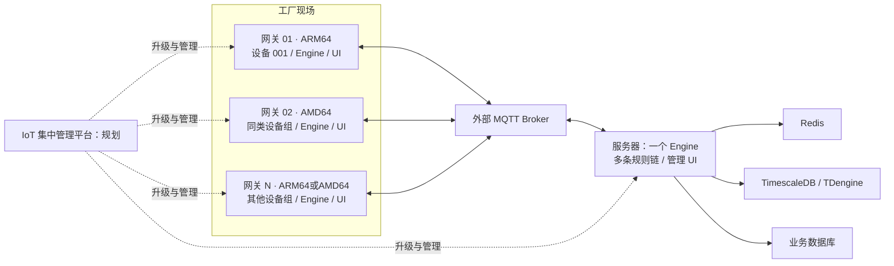

# IoT Rule Engine

**一切皆插件，核心负责编排与治理。**

[简体中文](README.md) | [English](README.en.md)

IoT Rule Engine 是用 Go 编写的工业规则引擎，包含可视化管理 UI。一个工厂可以部署多个独立 Linux 采集网关，每个网关运行一个 Engine；服务器集中运行一个 Engine，承载多条业务规则。

## 应用架构



边缘链：`PLC Source → 转换 → 持久缓冲 → MQTT Sink`；下发链：`MQTT Source → 目标/有效期检查 → PLC Sink`。服务器通过 MQTT Source 接收多个网关数据，再经处理、映射和缓存分支写入时序库或业务数据库。

详见[多网关架构与可靠性边界](docs/multi-gateway.md)。西门子 S7 已有官方 Source/Connector/Sink；FANUC、三菱完整插件和 Fleet 集中管理仍为规划能力。

## 核心能力

- 多规则 DAG、不可变规则版本、部署实例和运行态指标。
- Source、Processor、Sink、Connector 均通过 SDK 插件扩展。
- 同一 Engine 内一个插件产物对应一个 OS 进程，多个规则节点获得独立实例。
- 多个 Source/Sink 可绑定同一个 Connector Resource；不同网关的资源彼此独立。
- S7 按需求复用会话，批量读、串行读写、latest-only 扫描和故障退避。
- MQTT 长连接、数据库连接池、Redis 关系映射与 JavaScript 转换。
- 内置 NATS 默认回环地址、随机端口；可靠模式持久化规则边。
- SQLite 自动初始化；React UI 内嵌发行程序，API 与 UI 同源。
- 插件市场按平台下载、校验 SHA-256、Sigstore 身份与握手；保留已验证版本用于回滚。

## 快速开始

源码开发要求 Go 1.25+、Node.js 22。五个仓库独立构建，不需要 `go.work` 或本地 `replace`。

```bash
export GOWORK=off
export IOT_RULE_ADMIN_PASSWORD='Replace-With-A-Strong1!'
export IOT_RULE_DATA_DIR="$PWD/data"
export IOT_RULE_LISTEN='127.0.0.1:11011'
export IOT_RULE_INSTANCE_ID='factory-a-gateway-01'
go run ./cmd
```

首次管理员为 `admin`，只存 bcrypt 哈希；环境变量仅在首次创建时使用。`--config configs/config.yaml` 可显式使用旧 YAML 引导，省略时使用内置默认配置。已有数据库中的业务配置继续生效，部署环境决定数据库位置和监听地址。

前端开发使用另一个终端：

```bash
cd ui
npm ci
npm start
```

发行包通过 `deploy/release.sh` 先构建 UI 再嵌入 Engine。安装脚本源码在 `deploy/iot-rule-engine.sh`，支持 Linux AMD64/ARM64、systemd、版本校验、升级和回滚。正式发布版本通过 GitHub Release 提供，开发检出不自动安装全部插件。

## 与 Node-RED 对比

| 维度 | IoT Rule Engine | Node-RED |
| --- | --- | --- |
| 重点 | 工业设备采集、资源生命周期和受控运行 | 通用低代码集成、丰富社区节点和快速原型 |
| 连接共享 | 一级 Connector Resource，统一探测、引用和协议策略 | configuration node 支持连接共享，行为取决于节点实现 |
| 插件运行 | 进程隔离，规则实例独立 | 通常运行于 Node.js Runtime |
| 交付 | 独立签名制品和受控 Hub | npm / Palette 生态更成熟广泛 |

不宣称未经基准测试的性能优势。[完整比较与官方资料](docs/node-red-comparison.md)。

## 仓库与文档

- [Engine](https://github.com/punk-one/iot-rule-engine)：运行时、API、调度、Connector 治理和管理 UI。
- [Plugin SDK](https://github.com/punk-one/iot-rule-plugin-sdk)：v1.0.0 公共契约，至少三年兼容承诺。
- [Official Plugins](https://github.com/punk-one/iot-rule-plugins)：独立模块、独立版本和平台制品。
- [文档入口](docs/README.md)、[连接生命周期](docs/connector-lifecycle-v1.md)、[SDK 接入](docs/sdk-v1-integration.md)。

## 验证

```bash
GOWORK=off go test ./...
GOWORK=off go test -race ./...
GOWORK=off go vet ./...
cd ui && CI=true npm test -- --runInBand && npm run build
```

## 许可证

[GNU AGPL-3.0-only](LICENSE)。
