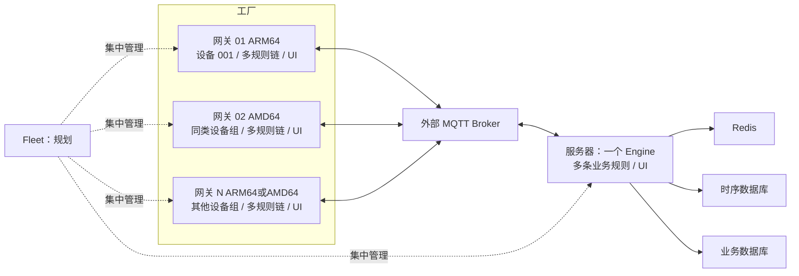

# 一切皆插件：多网关工业数据架构

一个工厂有多个独立 Linux 网关；每个网关运行一个 Engine 和本地管理 UI，可绑定单台设备或一组设备。服务器运行一个集中 Engine，承载多条业务规则。边缘与服务器使用同一套软件，通过安装预设和规则配置选择角色。

架构源文件为 [multi-gateway.mmd](architecture/multi-gateway.mmd)。FANUC、三菱和 Fleet 管理通道在完成各自验收之前标记为规划，不能作为已支持能力。



## 规则链

边缘上行：`PLC Source → 转换/变化检测 → buffer-node → MQTT Sink`。边缘下行：`MQTT Source → 目标和有效期检查 → PLC Sink`。服务器遥测：`MQTT Source → 处理 → 时序数据库 Sink`。服务器业务：`MQTT Source → Redis 关系映射 → 业务数据库 Sink`。

Sink 是链的终点。写 Redis 缓存与数据库可分支执行；需要放在链中间的缓存必须是会继续发布事件的 Processor。持久缓冲只接受配置的下游 Sink 的确认，不以事件进入调度队列作为业务完成。

## 身份和采集归属

- `factory_id` 标识工厂，`gateway_id` 标识网关，`device_code` 标识设备。
- 每台设备有唯一采集归属；同一型号设备仍分别创建 Connector Resource。
- Connector 只能在同一个 Engine 内跨规则复用。不同网关各自持有会话。
- 同一 PLC 的读写共享串行门禁；当前多个 Source 的点位请求不会跨规则合并。
- 同一网关内同一插件产物只启动一个进程；每个规则节点通过 SDK ServeFactory 创建独立实例。
- MQTT 显式 Client ID 保持不变；省略时以本机实例身份和 Resource ID 派生稳定值。

推荐设置 `IOT_RULE_INSTANCE_ID`，例如 `factory-a-gateway-01`。不要克隆网关身份、MQTT Client ID 或已初始化的数据库到另一台网关。

## 主题与事件

推荐主题：

```text
v1/factories/{factory}/gateways/{gateway}/telemetry
v1/factories/{factory}/gateways/{gateway}/devices/{device}/commands
v1/factories/{factory}/gateways/{gateway}/command-results
v1/factories/{factory}/gateways/{gateway}/status
```

遥测保留 `device_code`、`data`、毫秒 `time`，并增加 `schema_version`、`factory_id`、`gateway_id`、稳定 `event_id`。补传沿用原来的采集时间和事件 ID。数据库以业务事件 ID 建立幂等约束。

指令包含 `command_id`、目标设备和有效期；默认不使用 retained。过期或重复指令拒绝执行。PLC 写入超时属于结果未知，不自动重复写，应通过后续读取确认。

## 可靠性边界

`executor.delivery.mode: reliable` 会先持久化每条规则边，目标节点完成后才确认该边。持久 buffer 将遥测保存到独立规则/节点文件，直到指定 Sink 通过 SDK v1 PublishAck 成功确认。缓冲记录和字节上限到达时拒绝新记录，保持已有数据。重放速率可配置，重复事件由服务器业务库幂等处理。

MQTT Sink 的成功确认表示 Broker 已接收，不表示业务数据库已提交。要求入库后才删除边缘记录的场景还需配置应用级回执链，不能用 MQTT PUBACK 代替数据库确认。内存缓存、Redis 查询缓存、MQTT Session 和遥测持久队列有不同的用途。

一台网关故障只影响它负责的设备；Broker 不可达时，网关继续采集并受限缓冲。服务器停止但 Broker 仍可达时，边缘仍可能收到 PUBACK 并删除已发送记录；服务器离线期间的保存必须另行配置 Broker 持久订阅及验证，或实现应用级入库回执，当前默认链不承诺覆盖该窗口。Hub 暂时不可用时，已安装插件和规则继续运行。默认不自动将设备迁移到其他网关。

## 安装与升级

Linux AMD64 和 ARM64 使用同一安装脚本，下载对应架构的签名包。UI 嵌入 Engine，浏览器同源访问 `/api/v1`。`--config` 是可选 YAML 兼容入口，默认配置编译进程序；数据库位置和监听地址由部署环境覆盖。

插件按 ID、版本和平台独立打包，安装一个插件不下载全量插件包。Hub 验证签名、摘要和 ELF 平台；Engine 下载后再次验证。已有规则正在使用的插件必须先停止相关实例再升级，旧版本保留以供本地回滚。

## 集中管理的边界

Fleet 是独立控制面，负责网关注册、期望版本、任务状态和审批审计；Hub 只负责发布目录及制品。规划采用网关主动建立出站 mTLS 通道。升级分小批次执行，设备采集归属不因控制面重启而改变。远程执行只接受固定的声明式任务，不提供任意 Shell。
